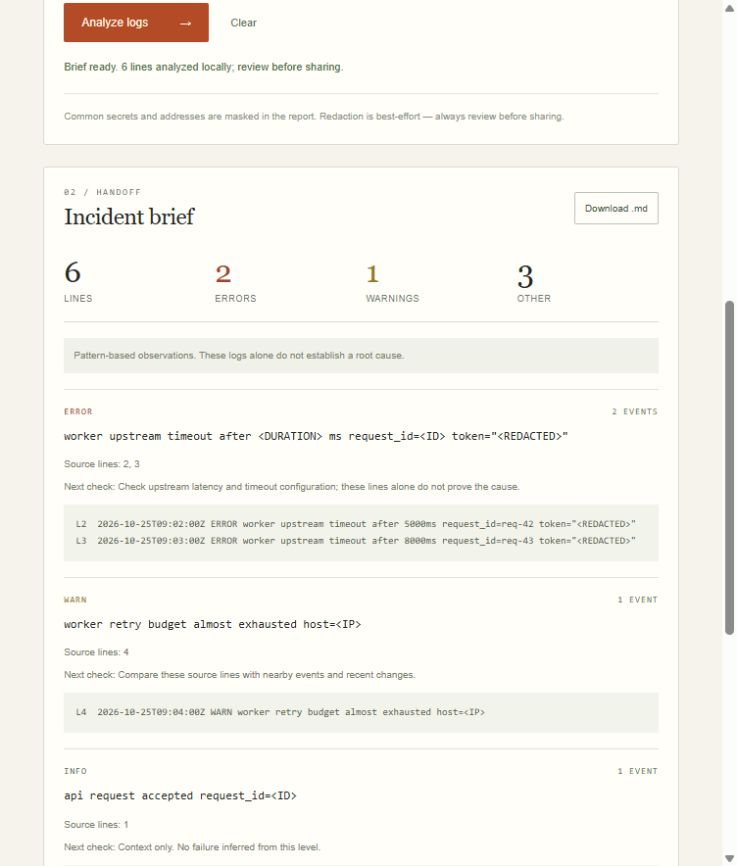

# Incident Brief

[](https://github.com/Seranov67/incident-brief/actions/workflows/verify.yml)

Technical documentation for a local log-triage proof of concept.

## Run
Node.js 22+. No runtime dependencies or install step.

```sh
git clone https://github.com/Seranov67/incident-brief.git
cd incident-brief
npm start
```

Open http://127.0.0.1:4317. Run `npm test` for the Node unit and HTTP integration tests.

Load example → Analyze logs → inspect evidence → Download .md.
Expected: 6 lines, 2 errors, 1 warning, one repeated timeout group.

## Behavior and limits
Plain text with explicit uppercase level tokens or JSONL level/severity fields.
200 KiB / 2,000 non-empty lines. Top eight groups displayed; totals/source cover all input.
Original source lines remain traceable. Common secrets/addresses are masked in output.
All input remains in browser memory; editing invalidates export, reload/clear loses input.
Raw input stays visible in the editor: use synthetic logs for recordings.
Pattern matching is not a diagnosis or a comprehensive secret detector. Review exports.

## Provenance and license
New code created during Build With AI: Basics 2026 using the official Devpost Learn Skill Pack.
Scenario and implementation explicitly delegated by the participant; planning artifacts in [devpost](devpost/).
AI coding assistance used for planning, implementation and tests. No inference model runs on logs.
No existing product or factory-starter code reused. No runtime dependencies or external calls.
Official course material is installed locally and excluded from publication; provenance is in skills-lock.json.
The personal learner profile is excluded and was never tracked.
[MIT license](LICENSE).

## Review materials
[Package status](PACKAGE.md). [App map](devpost/app-map.html) (open locally).
[32-second demo](docs/incident-brief-demo.mp4) · [recording notes](docs/demo-notes.md) · [submission draft](docs/submission-copy.md).


Not submitted to Devpost. Factual AI-assisted copy was requested by the participant; personal exit-survey answers were supplied directly and kept outside this repository. Final participant review remains.

## YouTube update — 2026-10-25
Demo uploaded by the participant: https://www.youtube.com/watch?v=_Q5n3nrQPvo
Title: Incident Brief — Local Log Triage Demo; player duration 32 seconds. Public oEmbed metadata resolved without credentials; browser playback observed. This supersedes earlier upload-pending notes. Devpost project details saved as DRAFT, 3/5 steps: About, JavaScript tag, source URL and video URL. Additional info/final review remain; NOT SUBMITTED.
